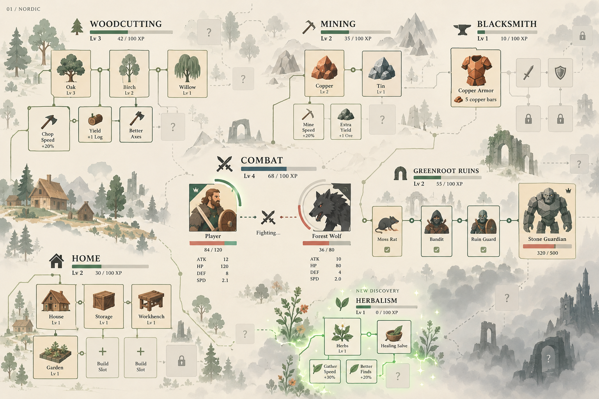
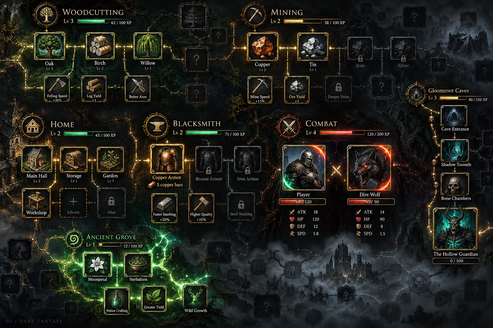
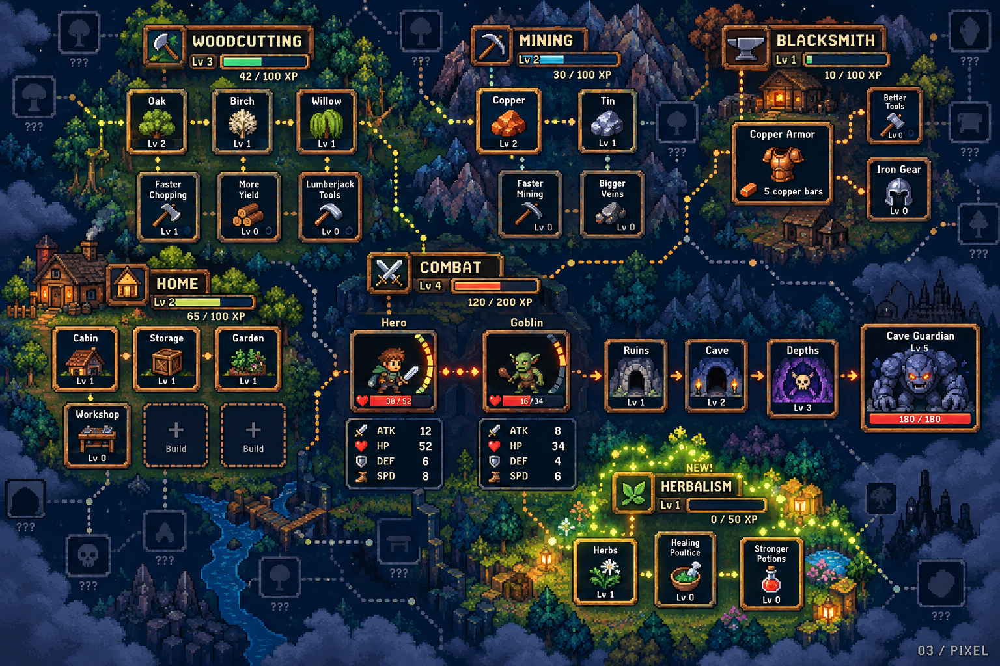
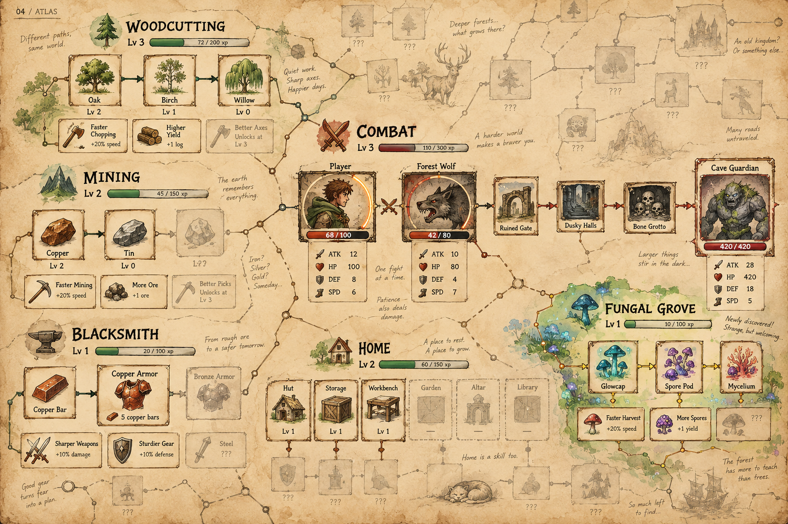
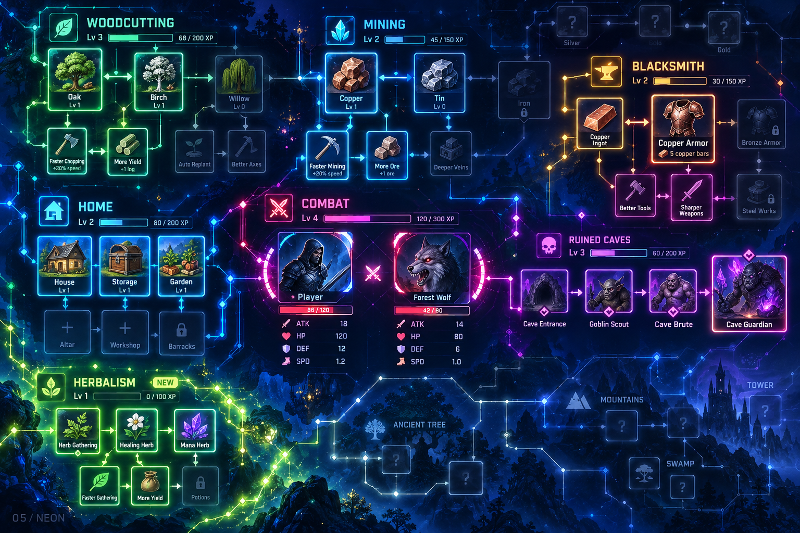
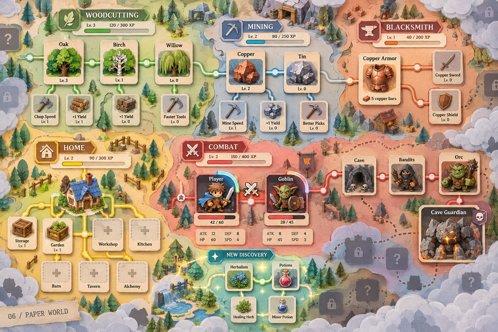
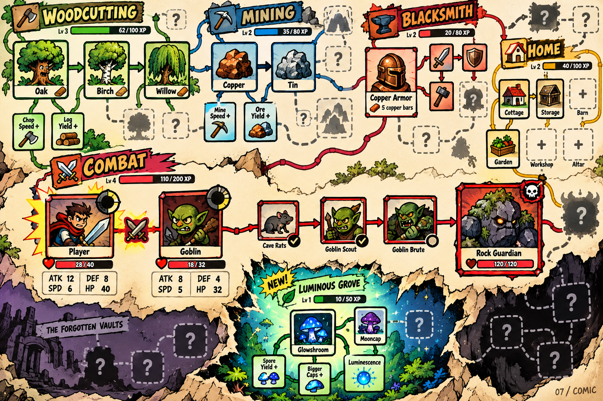
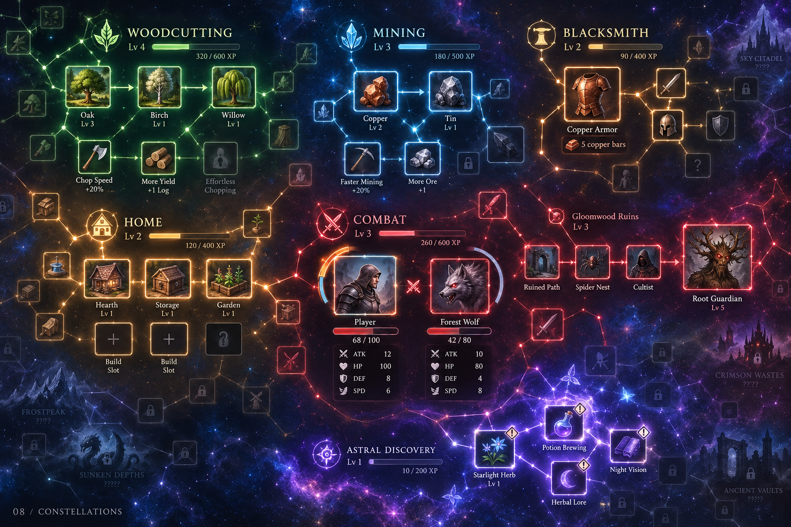

# Otte visuelle bud

Genereret den 16. oktober 2026 med det indbyggede imagegen-værktøj. Der er endnu ikke valgt en endelig stil. Prompts er bevaret i [billedprompts.md](billedprompts.md).

Billederne er stilskitser. Angrebsindikatoren skal i det endelige design følge den firkantede kant; de genererede billeder rammer ikke konsekvent den detalje. Tal og ekstra mekanikker i billederne er illustrative.

## 1. Nordisk minimalisme

Lyse flader, rolige farver og enkelt overblik.

## 2. Mørk fantasy

Ornamenterede rammer, mystik og truende bosser.

## 3. Hyggelig pixelkunst

Retrocharme og små detaljerede miljøer.

## 4. Håndtegnet eventyrkort

Pergament, akvarel og skjulte blyantsskitser.

## 5. Neon og hologrammer

Lysende forbindelser og stærke farvekoder.

## 6. Papirklip og brætspil

Fysiske brikker, bløde farver og byggepladser.

## 7. Tegneserie og kaos

Tykke streger, karakterfulde monstre og humor.

## 8. Kosmisk stjernekort

Skill-klynger som stjernebilleder i en enorm verden.

